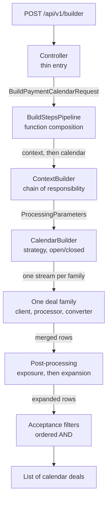
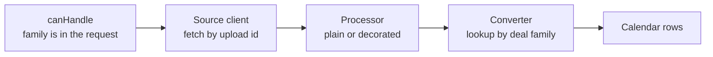
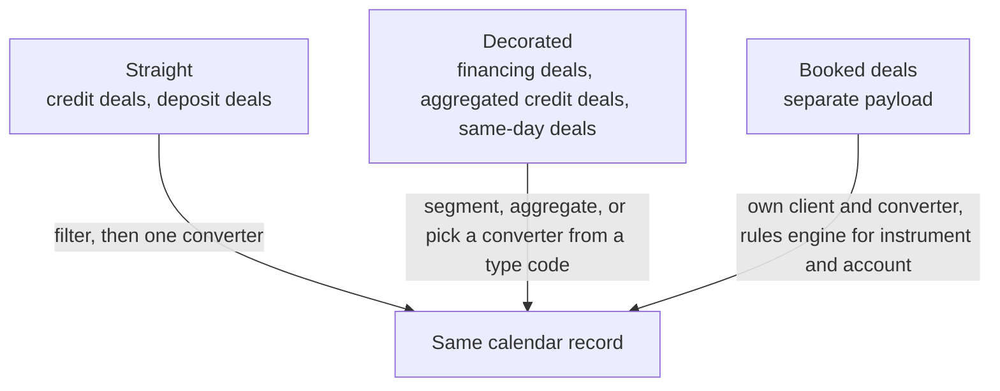
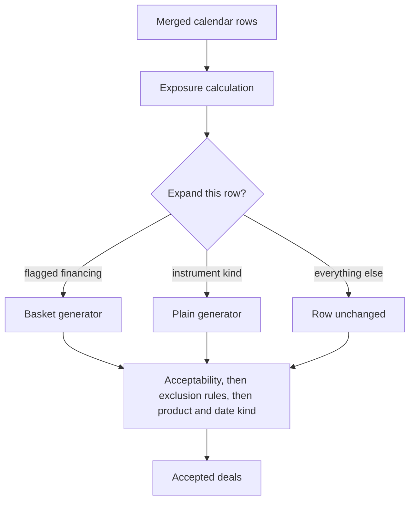

# Calendar deals list

A payment calendar builder turns one request into a list of deals. Context is assembled once, each deal family is a plugin, and row policy runs after every family has produced the same record type.

## Build flow

The controller only correlates the request and starts one function. `BuildStep` is a function, and the pipeline is context composed with calendar build. A new stage is another function in that chain.

Context handlers run only for deal families present in the request, in a declared order: rates, clients, securities, then portfolios and market context. Later stages read that finished context. Dictionaries are reached through one repository facade.

`CalendarBuilder` receives every handler from the container, keeps those that match the request, and merges their streams. A new deal family is a new handler. The builder does not grow a switch.

## One deal family

Three shapes share that exit type:

## After the merge

Generators are selected from a map by strategy name. A parameter builder assembles their input. Shared row math lives in a base generator.

Acceptance is one predicate: filters are ordered and combined with AND. A new rule is another filter with an order.

## Patterns

| Pattern | Where it sits | What stays closed |
| --- | --- | --- |
| Pipeline | Two build steps composed as functions | Controller and the other stage |
| Chain of responsibility | Context handlers, filtered and ordered | The context loop |
| Strategy | Handlers chosen by the request | Calendar builder |
| Template method | Source fetch and the shared generator | HTTP fetch and row math |
| Registry | Map from deal family to converter | Processors, which only look up |
| Decorator | Financing, aggregated credit deals, same-day deals | Default conversion |
| Builder | Expansion parameters | The two generators |
| Composite | Ordered acceptance filters | The final pass |
| Rules engine | Exclusion rules; instrument and account on booked deals | Filter and converter code |
| Facade | Dictionary access | Handlers and generators |

A new uploaded deal family needs a source client, a converter for that family, and a handler that checks the request. The pipeline, the converter registry, and the acceptance chain pick it up.
